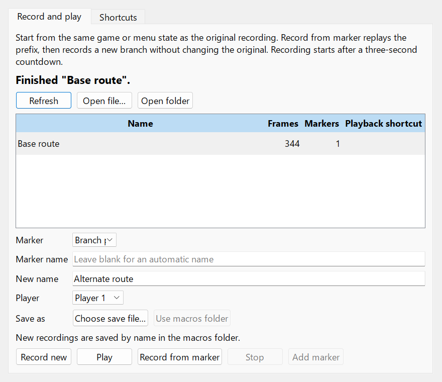
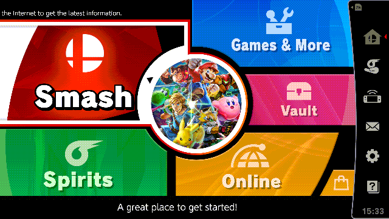

# One recording, two routes

Record the shared opening once, then **branch at a marker** to create different
endings. Here, both routes open Smash's submenu; one selects **Tourney**, the other
**Special Smash**.

## 1. Record the base route

Start at the main menu with **Smash** highlighted. Open **Tools → Input Macros…**,
choose your player, and enter **Base route** as the new name.

Click **Record new**. Return to the game during **3–2–1**; **red means recording**.
Open the Smash submenu and leave **Smash** highlighted. Press **Ctrl+Shift+M** to
place a marker here. Then move down to **Tourney** and press **Ctrl+Shift+F12** to
stop and save.

Tip: for a named marker like **Branch point**, reopen Input Macros while recording,
enter its **Marker name**, and click **Add marker** instead of using the shortcut.

## 2. Reuse the opening, record a new ending

Reset to the **same starting state**, including menu selections: move back up to
Smash, then back out to the main menu. Macros replay inputs; they do not restore
savestates.

Open Input Macros, select **Base route** and its marker, enter **Alternate route**,
then click **Record from marker**.

After the countdown, **blue means the opening is playing back**. At the marker,
**red means you're recording again**. Move down twice to **Special Smash**, then
stop. Your new named file contains the shared opening plus this ending;
**Base route stays unchanged**.

## 3. Replay and share

Reset the game, select either recording, and click **Play**. Bind playback to a
keyboard shortcut or gamepad combination for quick access. Marker shortcuts also
support both; configure them in **Shortcuts**.

To make your own clip, choose **Tools → Record GIF…** before replaying, then
**Tools → Stop GIF Recording** afterward. GIF and macro recording stop separately.
These real GIFs capture only the game image, so Eden's blue/red indicators and
dialogs aren't included.

See [macro controls and CLI playback](InputMacros.md) or [GIF options](GIFRecording.md).
